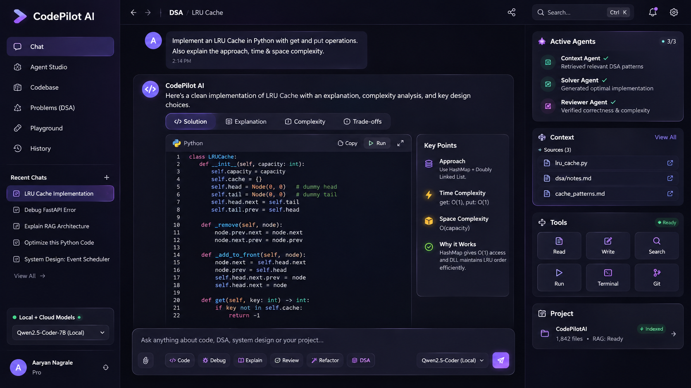

# CodePilot AI

<p align="center">
  
  
  
</p>

<p align="center">
  <strong>An AI-powered coding assistant</strong> for DSA solving, debugging, code generation, and codebase understanding.
</p>

---

## 🚀 Live Demo



> Note: Replace `frontend/screenshot.png` with an actual screenshot of your running application.

---

## 📖 Features

### ✨ AI Chat Workspace
- Interactive chat interface with streaming responses
- Three-agent architecture (Context → Solver → Reviewer)
- Real-time code generation and explanation

### 🤖 Agent Studio
- Manage and configure AI agents
- Select models per agent role
- View execution history
- Agent status monitoring

### 📂 Codebase Explorer
- File system navigation
- RAG-enabled context retrieval
- Code preview with syntax highlighting
- Vector database integration

### 📚 DSA Practice
- Solve algorithm problems
- Language selection (Python, JavaScript, Java, C++)
- Embedded code execution sandbox
- Solution analysis and explanation

### ⚙️ Settings & Configuration
- Model selection per agent role
- Provider configuration (OpenAI, Anthropic, Gemini, DeepSeek)
- RAG parameters tuning
- Appearance customization

---

## 🏗️ Architecture

```
                    ┌──────────────────────────────┐
        VS Code ──▶│  FastAPI /v1  (REST/WS)     │
                    └──────────────┬──────────────┘
                                   │
                           ┌───────▼────────┐
                           │  Orchestrator  │ Budgets ── Fix Loop
                           └───┬────┬┬┬─────┘
                      ┌─────────┘    │      └───────────┐
                      ▼              ▼                 ▼
               ┌──────────┐   ┌──────────┐     ┌──────────┐
               │ Context  │   │  Solver  │     │ Reviewer │
               │ Reader   │   │ Writer   │     │ Verifier │
               └────┬─────┘   └────┬─────┘     └────┬─────┘
                    │              │                │
                    ▼              ▼                ▼
         ┌───────────────────────────────────────────────┐
         │        Tool Registry (Sandboxed)             │
         │  files, search, git, terminal, sandbox    │
         └───────────────────────────────────────────────┘
                    │
    ┌───────────────┼──────────────┬─────────────┐
    ▼               ▼              ▼             ▼
  PostgreSQL      Qdrant       LLM Providers   Docker
   (State)      (Embeddings)   (Adapters)    (Execution)
```

**Key Design Principles:**
1. **Context is retrieved, not dumped** - Only relevant code reaches the model
2. **Writing and reviewing are separate** - Agents have distinct capabilities
3. **Everything is replaceable** - Protocol-based architecture

---

## 🚀 Quick Start

### Prerequisites

| Tool | Version |
|------|---------|
| Python | 3.12 (managed by uv) |
| [uv](https://docs.astral.sh/uv/) | 0.11+ |
| Docker + Compose | v2+ |
| Node.js | 20+ |

### 1. Configure API Keys

```bash
cp .env.example .env
```

Edit `.env` and add your LLM provider API keys:
```env
OPENAI_API_KEY=sk-...
ANTHROPIC_API_KEY=sk-...
GEMINI_API_KEY=...
DEEPSEEK_API_KEY=...
```

### 2. Start Backend Services

```bash
docker compose --env-file .env -f docker/compose.yaml up -d postgres qdrant
```

### 3. Start the Backend API

```bash
cd backend
uv sync --all-groups
uv run uvicorn codepilot.app:create_app --factory --reload
```

The API is now at `http://127.0.0.1:8000` with docs at `/docs`.

### 4. Start the Web Frontend

```bash
cd frontend
npm install
npm run dev
```

Visit <http://localhost:5173> to see the application.

### 5. Verify Everything Works

```bash
# Health check
curl http://127.0.0.1:8000/v1/health

# List providers
curl http://127.0.0.1:8000/v1/providers
```

---

## 🐳 Alternative: Full Stack with Docker

```bash
cp .env.example .env
docker compose --env-file .env -f docker/compose.yaml up --build
```

---

## 🧪 Quality Gates

```bash
# Backend tests and checks
cd backend
uv run pytest --cov=codepilot --cov-report=term-missing
uv run ruff check . && uv run ruff format --check .
uv run mypy

# Frontend checks
cd frontend
npm run typecheck   # tsc --noEmit (strict)
npm run build       # production build
```

---

## 🔧 Configuration

Environment variables control all settings:

| Variable | Default | Description |
|----------|---------|-------------|
| `CODEPILOT_ENVIRONMENT` | `development` | `development` \| `test` \| `production` |
| `CODEPILOT_SERVER__PORT` | `8000` | Backend port |
| `CODEPILOT_DATABASE__URL` | local Postgres | Database connection |
| `CODEPILOT_VECTOR_DB__URL` | `http://localhost:6333` | Qdrant vector store |

---

## 📚 API Endpoints

| Endpoint | Method | Purpose |
|----------|--------|---------|
| `/v1/health/live` | GET | Process liveness |
| `/v1/health/ready` | GET | Dependency readiness |
| `/v1/health` | GET | Full health snapshot |
| `/v1/providers` | GET | List LLM providers |
| `/v1/sessions` | POST | Create chat session |
| `/v1/sessions/{id}` | GET | Get session messages |
| `/v1/sessions/{id}/messages` | POST | Send message |

---

## 🗺️ Roadmap

| Milestone | Features | Status |
|-----------|----------|--------|
| **M0** | Foundation, config, health, Docker | ✅ Done |
| **M1** | LLM abstraction, providers, retries | ✅ Done |
| **M2** | Tool layer, sandboxed execution | ⏳ Next |
| **M3** | Docker execution sandbox | Planned |
| **M4** | Tree-sitter parsing, RAG indexing | Planned |
| **M5** | Hybrid retrieval, context packing | Planned |
| **M6** | Full agent orchestration | Planned |
| **M7** | PostgreSQL persistence | Planned |
| **M8** | WebSocket chat, authentication | Planned |

---

## 🤝 Contributing

Contributions welcome! Please ensure:
- TypeScript strict mode passes (`npm run typecheck`)
- Backend type checking passes (`uv run mypy`)
- Code is formatted (`uv run ruff format`)
- Linting passes (`uv run ruff check`)

---

## 📜 License

License to be selected before first public release.

---

Made with ❤️ by the CodePilot team.